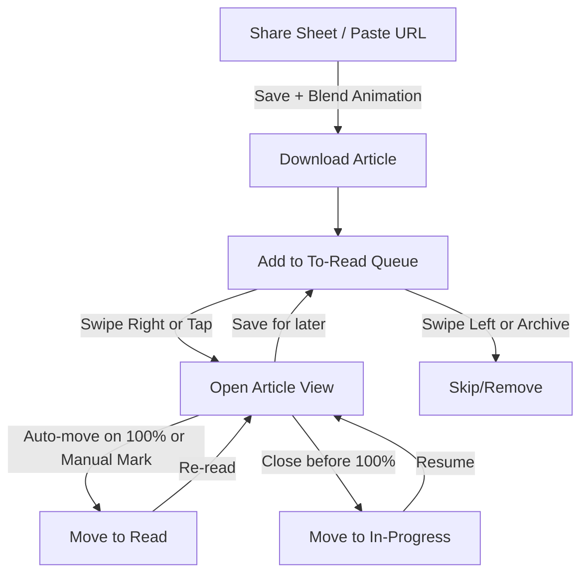

# Beans: Offline Reader - Strategic Collaboration

## Phase 1: Business & Product Strategy ✅

### The Problem
Commuting and distraction-free reading - users want to consume saved articles without internet dependency and without ads/clutter.

### User Persona
Power users looking for a Pocket competitor with enhanced privacy and offline capabilities.

### Our Wedge (Differentiation)
- **Pure Offline-First**: No sync dependency, works completely offline
- **Privacy-First**: Local-only storage, no cloud data collection
- **Future Path**: AI features (summarization, tagging) post-MVP, running locally

### Business Model
TBD - decision deferred until post-MVP

---

## Phase 2: Design & Experience (In Progress)

### The "Magic" Test Questions
- [ ] What does the "save article" experience feel like?
- [ ] How do we make offline syncing feel invisible?
- [ ] What's the onboarding flow like?

### Core Experience Flows

#### 1. Saving an Article: How does the user save?
- Browser extension? (One-click save from any site)
- Share sheet on mobile? (iOS/Android native integration)
- Paste URL in app? (Manual fallback)
- **User Decision**: iOS app only, share sheet primary interaction + URL paste fallback

#### Coffee Theme Details
- "Blending beans" animation when saving an article
- Warm color palette, subtle animations
- Not gimmicky - feels cozy, not a coffee shop menu
#### 2. The "Offline" Feeling
- Should articles download immediately on save? (Instant gratification)
- Or queue for later when WiFi is available? (Bandwidth conscious)
- **My Take**: Instant download feels more magical. "It just works."
- **User Decision**: ✅ Immediate download on save

#### 3. Reading Experience
- Typography-focused? (Medium/Substack style)
- Customizable themes? (Dark mode, sepia, fonts)
- Progress tracking? (Reading position, estimated time)
- **User Decision**: ✅ All of the above
#### 4. Organization
- How do power users manage hundreds of articles?
- Tags? Collections? Search?
- **My Take**: Tags + collections + full-text search (SQLite FTS5 is great for this)
- **User Decision**: Three-section model
  - **To-read**: Tinder-style swipe left/right navigation with quick article preview (name, author/site)
  - **In-progress**: Currently reading articles
  - **Read**: Completed archive

##### Section Transition Logic
- **Support both** manual marking as done AND auto-move based on reading progress
- **Note**: Swipe mechanism OK for MVP, can iterate if scalability becomes an issue 
### Friction Audit

#### What's annoying in Pocket?
- Sync can be finicky offline
- Article parsing fails sometimes
- Interface can feel cluttered

#### Where can we delight?
- "Download complete" haptic feedback
- Beautiful article preview cards
- Estimated reading time that's actually accurate

I want the entire app to be coffee themed - saving an article should be link blending beans with a little animation for the same
### Platform Decision
**Question**: Should we start with desktop/web first, or go cross-platform from day one? This affects our architecture significantly.

- **Desktop/Web First**: Electron/Tauri + Web extension
- **Cross-Platform**: React Native / Flutter (harder, broader reach)
- **User Decision**: ✅ iOS-only (SwiftUI) for MVP

### Key Experience Decisions (So Far)
- Distraction-free reading mode
- Fast article fetching and parsing
- Clean, minimal interface

### UI Navigation Flow

**Section Definitions:**
- **To-Read**: Discovery queue, swipe navigation, fresh articles
- **In-Progress**: Partially read, easy to resume
- **Read**: Completed archive, searchable

---

## Phase 3: Architecture & Design (Pending)

### Technical Options to Consider
- Storage engine (SQLite, IndexedDB, etc.)
- Article parsing (Readability.js, Mercury, custom)
- Platform focus (Web, Electron, Tauri, Native)

---

## Documentation Structure

- **PRODUCT_SPEC.md**: Product vision, UX flows, features, success criteria
- **TECHNICAL_SPEC.md**: Architecture, tech stack, data models, implementation details
- **COLLABORATION.md**: Working document for strategic discussions and decisions

---

*Last updated: 2025-12-25*
