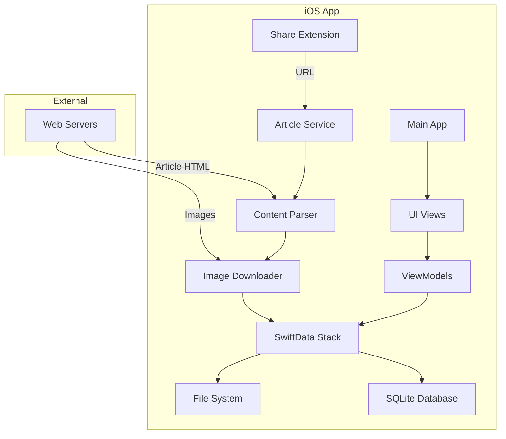

# Beans: Project Context

## 1. Business Context (The "Why")
**Beans** is a privacy-first, offline-first article reader designed for commuters and power users who want a distraction-free, delightful reading experience without the clutter or privacy concerns of cloud-based services like Pocket.

- **The Pitch**: "A warm cup of coffee for your articles."
- **Target User**: "The Coffee Reader" — technical power users who value privacy, read 10-50 articles per week, and need a reliable solution for offline reading (subways, planes).
- **Our Wedge**: Zero internet dependency, absolute privacy (local storage), and a "Magical" UX centered around coffee metaphors.

## 2. Technical Context
The project is built as a native iOS application to ensure the highest performance and the most "magical" feel.

- **Tech Stack**:
    - **Platform**: iOS 16+ (SwiftUI)
    - **Persistence**: SwiftData (Core Data / SQLite backend)
    - **Parsing**: Mozilla Readability (for content extraction)
    - **Images**: Kingfisher (async loading and local caching)
- **Architecture**:
    - **Offline-First**: All content and images are downloaded immediately on save.
    - **Local-Only**: No cloud sync; data stays on the device.
- **Key Metaphors & UX**:
    - **Save Moment**: "Brewing" or "Blending beans". The UI shows "Your coffee is ready!" with a "Sip Now" option.
    - **Reading Time**: Represented as a "5 min brew" or "5 min sip".
    - **Privacy**: Visible "Tracker Free" and "Encryption" badges in the UI.
    - **Discovery**: A card-style "Daily Brew" queue.

### System Architecture

## 3. Visual Identity
The project follows a warm, cozy "Coffee Shop" aesthetic.
- **App Icon**: A stylized coffee bean/book hybrid on a dark background.
- **Palette**: Deep espressos, warm lattes, and vibrant orange accents for primary actions.
- **Typography**: Elegant serifs for long-form reading and headers, paired with clean sans-serifs for metadata.
- **Key Screens** (Mockups in `/Images`):
    - `save_moment`: Features a delightful "brewing" state and immediate action buttons.
    - `to-read_discovery`: A card-based interface for effortless article discovery.
    - `reading_experience`: Theme-able (Light, Sepia, Dark) distraction-free reader.

## 4. Current State
- **Phase 1 (Strategy)**: COMPLETED. `COLLABORATION.md` and `PRODUCT_SPEC.md` are finalized.
- **Phase 2 (Experience)**: COMPLETED. Key flows (Save, Discover, Read) and organizational model (3-section) defined.
- **Phase 3 (Architecture)**: COMPLETED. `TECHNICAL_SPEC.md` defines the SwiftData schema and service layers.
- **Phase 4 (Shared Brain)**: COMPLETED. `CONTEXT.md` acts as the source of truth.
- **Phase 5 (Execution)**: IN PROGRESS.
    - **Persistence**: SwiftData Schema (`Article.swift`) and Service (`PersistenceService.swift`) implemented.
    - **Ingestion**: `ContentParser` (Readability.js) and `ArticleService` implemented.
    - **UI**: `InboxView` created for verification.
    - **Share Extension**: `ShareViewController` and `Info.plist` created.
- **Next Immediate Steps**:
    1.  **Integration**: Link files to Xcode Targets (See `walkthrough.md`).
    2.  **App Groups**: Enable App Groups capability to allow Share Extension to write to DB.
    3.  **Run & Verify**: Test the "Share to Beans" flow.

## 5. Key Decisions & Trade-offs
- **App Groups**: Essential for sharing the SwiftData container between the main app and the extension.
- **Native vs. Cross-Platform**: Chose Native (SwiftUI) to prioritize the "Magic" (haptics, smooth animations, native share sheet) over reach.
- **SwiftData vs. Realm**: Chose SwiftData for native integration and long-term support, despite Realm's speed in some edge cases.
- **Immediate Download**: Decisions made to download everything (including images) at the moment of Save to ensure the article is *guaranteed* to be ready for the subways.

---
*Last Updated: 2025-12-25*
*Session Start: Created initial CONTEXT.md based on AGENTS.md requirements.*
