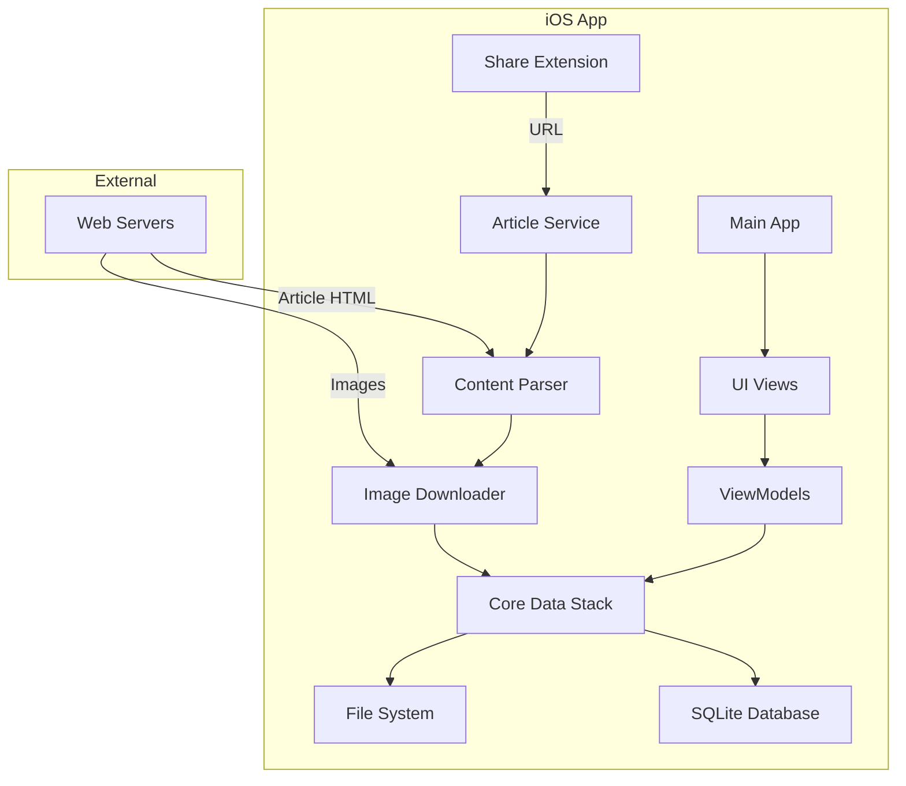
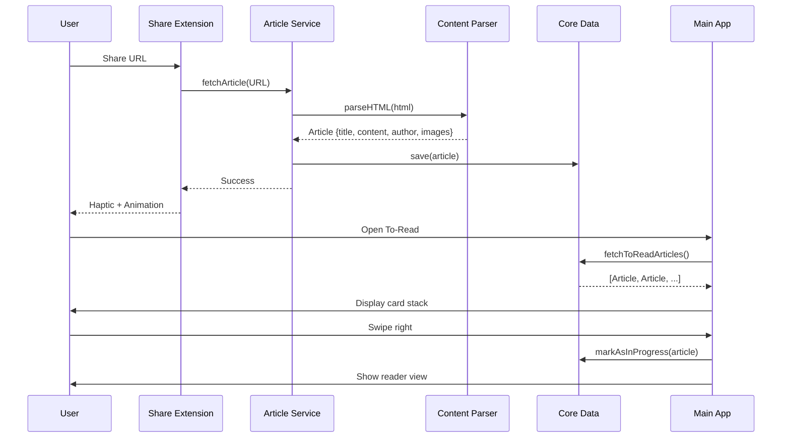

# Beans: Offline Reader - Technical Specification

## 1. Product Overview

**Mission**: A privacy-first, offline-first iOS article reader for commuters who want a distraction-free reading experience.

**Target User**: Power users who want a Pocket competitor with enhanced privacy and offline capabilities.

**Core Differentiators**:
- Pure offline-first (no sync dependency)
- Privacy-first (local-only storage)
- Coffee-themed delightful experience
- Post-MVP: Local AI features (summarization, tagging)

### App Architecture
**Pattern**: MVVM + Repository + Services
- **View**: Pure SwiftUI
- **ViewModel**: `@Observable` state management
- **Repository**: Facade over SwiftData
- **Service**: Stateless workers (Parsing, Image Fetching)

---

## 2. User Experience Flows

### 2.1 Save Article Flow
1. User shares URL from any app (Safari, Twitter, etc.) via iOS Share Sheet
2. "Beans" extension receives URL
3. Shows "blending beans" animation
4. Immediately fetches and parses article
5. Downloads full content + images
6. Saves to "To-Read" queue
7. Haptic feedback on completion

### 2.2 Discover & Read Flow
**To-Read Section**:
- Tinder-style card stack navigation
- Swipe right → Open article
- Swipe left → Skip/remove
- Card shows: Title, author/site, estimated reading time, domain favicon
- Tap card → Quick preview modal

**Reading View**:
- Clean, typography-focused reader
- Theme toggle (Light/Sepia/Dark)
- Font size adjustment
- Reading progress bar
- Auto-save reading position
- Mark as complete button
- Share button (re-add to To-Read)

**Section Transitions**:
- To-Read → In-Progress: Opened and read < 100%
- To-Read → Read: Manually marked complete OR read 100%
- In-Progress → Read: Read to 100% OR manual mark complete
- Any section → To-Read: "Save for later" action

### 2.3 Organization Flow
- Three tabs: To-Read / In-Progress / Read
- Full-text search across all sections (MVP+)
- Search by title, content, domain, tags (MVP+)

---

## 3. Technical Architecture

### 3.1 System Architecture



### 3.2 Data Flow



### 3.3 Tech Stack

| Component | Technology | Rationale |
|-----------|-----------|-----------|
| Platform | iOS 16+ (SwiftUI) | Native feel, best performance, offline-first |
| Language | Swift | Type-safe, great async/await, ecosystem |
| Database | SwiftData (SQLite) | Built-in, modern, offline-first, FTS support |
| Networking | URLSession | Native, background download support |
| HTML Parsing | Readability (Mozilla) | Reliable content extraction |
| Image Handling | Kingfisher | Async loading, caching |
| Persistence | FileManager | Local image storage |

### 3.4 Trade-off Analysis

**Why Core Data vs. Realm?**
- **SwiftData**: Modern, "magical" SwiftUI integration, type-safe (iOS 17+)
- **Realm**: Faster, but external dependency, steeper learning curve
- **Decision**: SwiftData for modern native integration and velocity

**Why SwiftUI vs. UIKit?**
- **SwiftUI**: Modern, declarative, faster development
- **UIKit**: Mature, more control, but more boilerplate
- **Decision**: SwiftUI for velocity and iOS 16+ baseline

**Why Native iOS vs. React Native/Flutter?**
- **Native**: Best performance, native feel, full platform APIs
- **Cross-platform**: Slower startup, larger bundle, compromise experience
- **Decision**: Native iOS for MVP, focus on delight

---

## 4. Data Model

### 4.1 Core Data Schema

```swift
// Article Entity
@Model
class Article {
    var id: UUID
    var url: String
    var originalURL: String
    var title: String
    var content: String
    var author: String?
    var siteName: String?
    var domain: String?
    var excerpt: String?
    var faviconURL: String?
    var readingTimeMinutes: Int
    var imageURL: String?
    var publishedDate: Date?
    var savedDate: Date
    var lastReadDate: Date?
    var readingProgress: Double  // 0.0 to 1.0
    var status: ArticleStatus    // toRead, inProgress, read
    var imageLocalPath: String?
    var isDownloaded: Bool
    
    @Relationship(deleteRule: .cascade)
    var tags: [Tag]
}

enum ArticleStatus: String, Codable, CaseIterable {
    case toRead
    case inProgress
    case read
}

// Tag Entity (MVP+)
@Model
class Tag {
    var id: UUID
    var name: String
    var color: String?
    var createdAt: Date
    
    @Relationship
    var articles: [Article]
}
```

### 4.2 File System Structure

```
Documents/
├── Articles/
│   ├── {article-id}/
│   │   ├── content.json
│   │   ├── hero-image.jpg
│   │   ├── inline-images/
│   │   │   ├── img-1.jpg
│   │   │   └── img-2.jpg
│   │   └── favicon.ico
│   └── ...
└── Thumbnails/
    └── {article-id}-thumb.jpg
```

---

## 5. Key Components

### 5.1 Service Layer

**ArticleService**:
- `fetchArticle(url: URL) async throws -> Article`
- `parseArticle(html: String) -> ParsedArticle`
- `downloadImages(article: Article) async`
- `saveArticle(article: Article) async throws`
- `deleteArticle(id: UUID) async throws`

**PersistenceService**:
- `fetchArticles(status: ArticleStatus) -> [Article]`
- `updateArticleProgress(id: UUID, progress: Double) async`
- `moveArticle(id: UUID, to: ArticleStatus) async`
- `searchArticles(query: String) -> [Article]`

### 5.2 UI Components

**ToReadCardView**: Tinder-style card with swipe gestures
**ReaderView**: Distraction-free reading view with themes
**SaveAnimationView**: Blending beans particle animation
**ReadingProgressView**: Progress bar with estimated time
**ThemeToggle**: Light/Sepia/Dark mode switcher

---

## 6. MVP Feature Scope

### Must-Have (v1.0)
- ✅ Share sheet integration
- ✅ Article fetching and parsing (Readability)
- ✅ Image downloading and caching
- ✅ Three-section organization (To-Read, In-Progress, Read)
- ✅ Tinder-style navigation for To-Read
- ✅ Reading view with theme toggle
- ✅ Reading progress tracking
- ✅ Manual section transitions
- ✅ Offline-first architecture
- ✅ Core Data persistence
- ✅ Coffee-themed animations

### Nice-to-Have (v1.1)
- ⭕ Full-text search (SQLite FTS5)
- ⭕ Tags and collections
- ⭕ Article editing (fix parsing errors)
- ⭕ Export (PDF, Markdown)
- ⭕ Backup/restore

### Future (Post-MVP)
- 🔮 Local AI summarization
- 🔮 Auto-tagging with ML
- 🔮 Smart article recommendations
- 🔮 iCloud sync (optional)
- 🔮 Web companion app

---

## 7. Technical Implementation Notes

### 7.1 Article Parsing Strategy
- Use Mozilla Readability for content extraction
- Fallback: Mercury Parser (if available)
- Manual override: User can edit article content
- Store both original HTML and parsed content

### 7.2 Image Handling
- Download all images to local storage
- Replace remote URLs with local paths in content
- Generate thumbnails for card previews
- Cache aggressively for offline reading

### 7.3 Background Processing
- Use BGAppRefreshTask for periodic sync
- Use URLSession background downloads for large images
- Handle app lifecycle events (save state on terminate)

### 7.4 Performance Considerations
- Lazy loading for article lists
- Image thumbnail generation for card stacks
- Core Data fetch limits (pagination for large libraries)
- Debounce search queries

---

## 8. Success Criteria

**Technical Metrics**:
- < 3s from share to download complete
- < 100ms article list load time
- < 50ms reader view render time
- Zero network dependency for reading

**User Experience Metrics**:
- Delightful save animation feels "instant"
- Reading experience is distraction-free
- Offline mode works flawlessly
- App feels native and responsive

---

*Version: 1.0*
*Last Updated: 2025-12-25*
